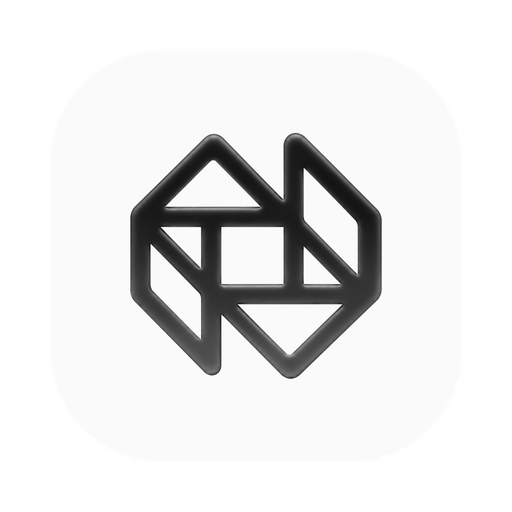
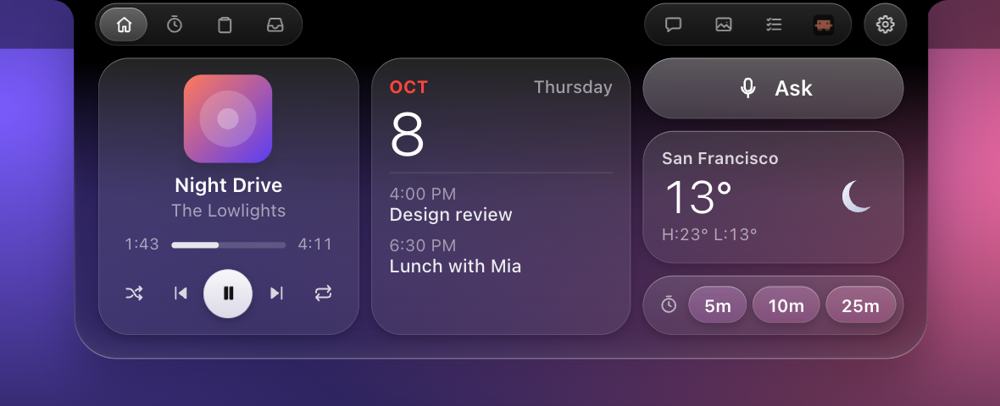
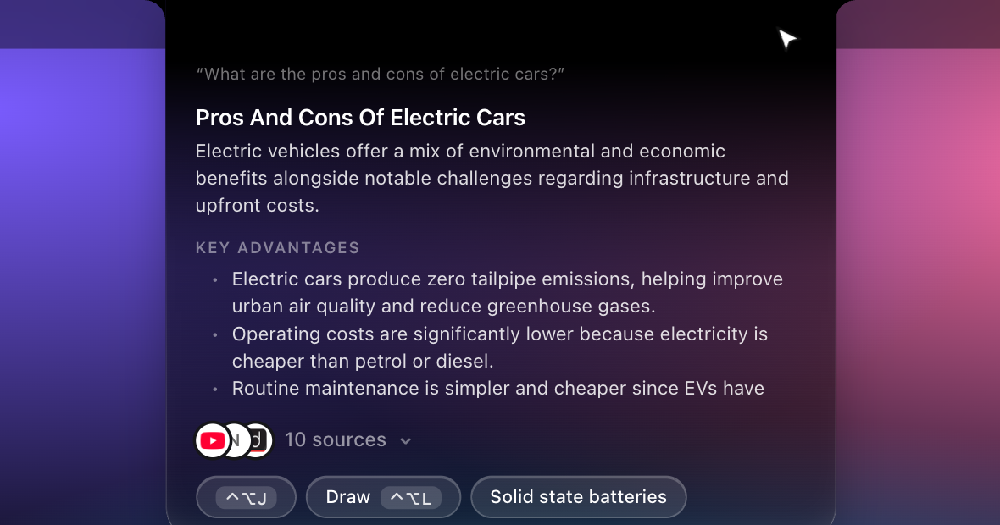
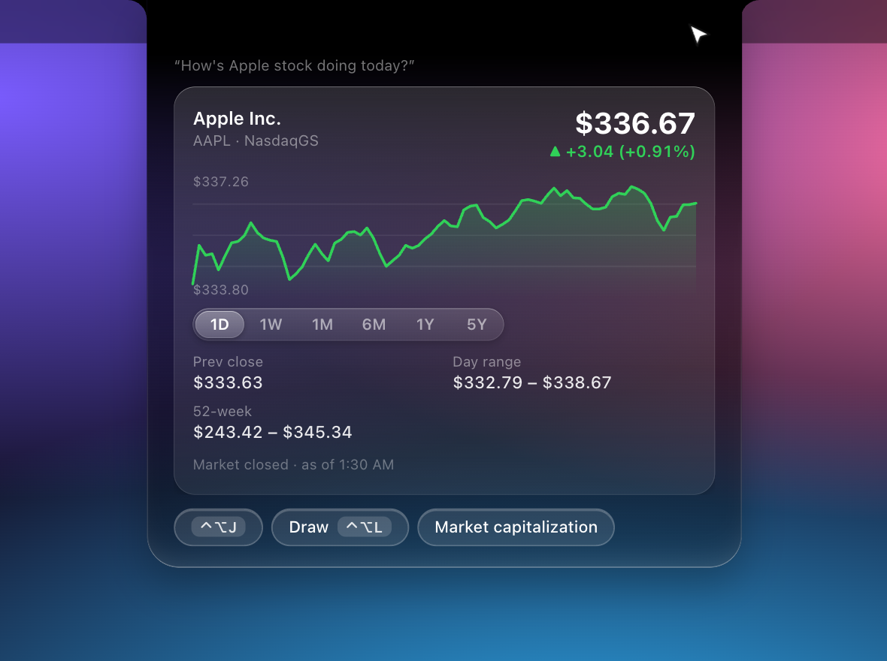
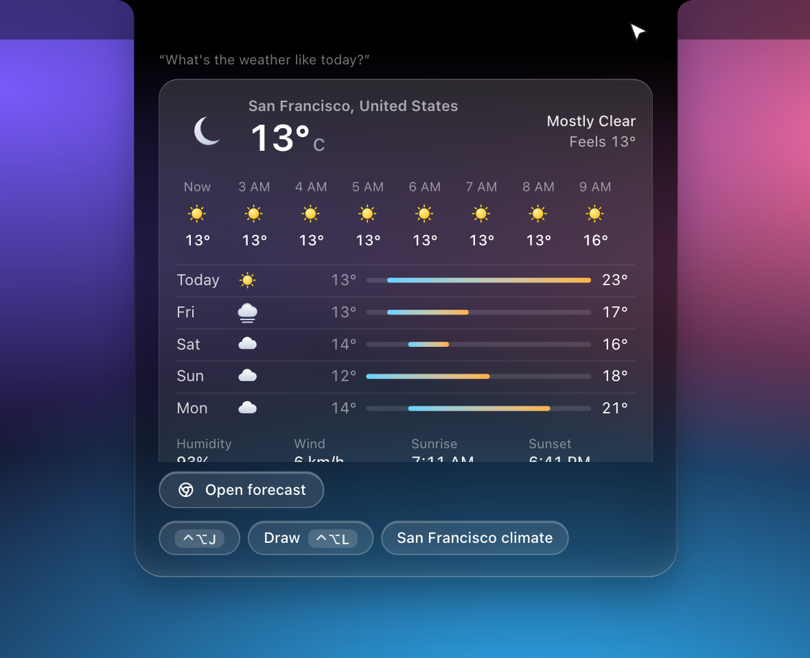

  

<h1 align="center">Focusel</h1>

<b>Your Mac's notch, turned into a voice assistant.</b> 
Press a key, say what you want, and the notch does it: answers, emails, notes, music, meetings, and dictation into any app.

  <a href="https://github.com/KNMNikhil/Focusel/releases/latest/download/Focusel.dmg"><b>⬇ Download for Mac</b></a> &nbsp;·&nbsp; Version 0.1.8 &nbsp;·&nbsp; macOS, Apple silicon, Macs with a notch

  

  <a href="#what-it-is">What it is</a> ·
  <a href="#shortcuts">Shortcuts</a> ·
  <a href="#dictation">Dictation</a> ·
  <a href="#what-you-can-do">Features</a> ·
  <a href="#permissions">Permissions</a> ·
  <a href="#your-data-stays-yours">Privacy</a> ·
  <a href="#install">Install</a> ·
  <a href="#license">License</a>

---

## What it is

Focusel lives in the notch at the top of your MacBook screen. Most of the time it is a small black bar that shows
what is playing or how long your timer has left. Hover over it and it opens. Press **⌃⌥J**, speak, and it
listens, understands and shows the result right there, without switching apps.

## Shortcuts

| Keys | What happens |
| --- | --- |
| **⌃⌥J** | Start listening. Say anything: a question, a command, a request. Press again to stop. |
| **⌃⌥L** | Draw around anything on your screen and ask about it (a photo, a chart, a receipt, an email). |
| **Hold fn** | Dictate: speak, let go, and your words are typed where your cursor was, in any app. |
| **fn + ⌥** (together) | Hands-free dictation. Press them together again to finish. |
| **Hold fn + ⌃** | Command mode: select text, hold, and say what to do with it ("make this formal", "translate to Hindi"). |
| **⌃⌘V** | Type your last dictation again. |
| **⌥⌘1 … ⌥⌘0** | Paste one of your last ten copies. |
| **Esc** | Close whatever the notch is showing, or cancel a dictation. |

## Dictation

Hold **fn** in any app (Gmail, WhatsApp, Notion, Notes, a terminal, a browser) and talk. Let go, and the words appear where your cursor was.

- **Starts the instant you press the key.** The microphone opens as fn goes down, so your first words are not cut off. It is off the moment you let go.
- **Written properly.** Punctuation and capitals, no "um"s, and a correction like "at five, no, six" becomes "6". Say "new line", "new paragraph" or "press enter".
- **Written for where you are.** Email is formal, laid out in paragraphs and closed with *Regards,* and your name, email and phone from the Intelligence page. Chat is casual. A terminal or code editor gets exactly what you said (`git checkout -b feature/login-page`).
- **Lists look like lists.** "Groceries: eggs, potatoes and bread" becomes a numbered list. Ordinary sentences stay ordinary.
- **Hands-free** with fn + ⌥, and **command mode** with fn + ⌃ to rewrite or translate selected text.
- **Your words.** Add names and terms, expand voice snippets ("my calendar link"), and let Focusel suggest corrected words that you approve.
- **Says so when nothing was said.** The notch shows "I have heard nothing" and nothing is typed.
- **History.** The last 100 dictations, encrypted on your Mac, with a before/after view. Switch it off any time.

Speech is recognised on your Mac, offline. The tidying step uses the AI (text only, never the sound) and can be switched off on the Dictation page.

## A look at the notch

<table>
  <tr>
    <td width="50%"> <b>Listening.</b> Press ⌃⌥J and just talk. It waits until you stop for a few seconds.</td>
    <td width="50%"> <b>At rest.</b> Music and timers show quietly in the notch, one on each side.</td>
  </tr>
</table>

### Ask anything, get one clear answer

Questions come back as a short, sourced answer. A question with several parts is answered once, together.

### The right card for the question

Prices, weather, conversions, maths, times, scores and news each get their own card.

<table>
  <tr>
    <td width="50%"></td>
    <td width="50%"></td>
  </tr>
</table>

---

## What you can do

- **Ask and learn.** Facts, comparisons, news, definitions, sports scores, maths and unit conversions.
- **Get things done.** Set timers, add reminders, write notes, create events, find files, open apps.
- **Write and send.** Draft an email from a few words, attach files from Finder, reply to something you selected.
- **Use your other apps.** Slack, Google Calendar, Drive, Sheets, Meet and more, all by voice.
- **Know what's happening.** Message notifications, incoming calls, music and timers appear in the notch.
- **Hand work to Claude Code.** Say what you want built or fixed and it works on a copy of your project.
- **Tell it about you once.** The Intelligence page keeps your role, skills, bio, résumé and contact details, encrypted on your Mac. Ask "who am I?" or highlight a form question (or circle it with ⌃⌥L), say "fill this in", and press Insert.
- **Dictate anywhere.** See [Dictation](#dictation).
- **Translate or explain anything you select.** Select text in any app, press ⌃⌥J and say "translate this to Hindi".

### Make the notch yours

In the app's **Notch** page, pick one of eight layouts for the notch's home page, choose which widget goes in each place (now playing, calendar, weather, ask, clipboard, timer and more), and switch each kind of pop-up on or off.

## Works with your apps

Anything that sends, posts, changes or deletes **shows you a preview first and waits for your click**.

| Category | Apps |
| --- | --- |
| Email | Gmail, Outlook |
| Calendar | Apple Calendar, Google Calendar |
| Notes and documents | Apple Notes, Notion, Google Docs |
| Productivity | Finder, Reminders, Google Sheets, Excel, Google Drive |
| Messaging and meetings | Slack, Microsoft Teams, Google Meet, Zoom |
| Media | YouTube, Spotify, Google Photos |
| Developer | Claude Code, GitHub, Figma |
| Social | LinkedIn, Reddit |
| Maps | Google Maps |

## Built into the notch

| Feature | What it does |
| --- | --- |
| Web answers | Sourced answers and the right card for each kind of question |
| Visual search | Draw around anything on screen and ask about it |
| Timer | Counts down live in the notch |
| Clipboard | Your last 50 copies, one click to copy again |
| File tray | Park a file on the notch and drag it out anywhere |
| Screenshot shelf | Every screenshot and recording lands in the notch |
| Quick notes | A to-do list and scratch notes, one hover away |
| Messages | iMessage and WhatsApp notifications you can read and answer |
| Calls | Phone, FaceTime and meeting calls with mute, video and end |
| Text shortcuts | Expand short codes like `;em` into your email address, anywhere you type |

## Permissions

macOS asks for these at setup or the first time you use a feature. Each is explained when asked, and refusing one only switches off the feature that needs it.

| Permission | Used for |
| --- | --- |
| Microphone | Hearing your commands and dictation, only while a key is held or a question is asked |
| Accessibility | Typing dictated words, reading selected text, pressing call buttons |
| Input Monitoring | Noticing the fn key (never what you type); text shortcuts |
| Screen Recording | Seeing the area you circle with ⌃⌥L (nothing is saved) |
| Automation | Notes, Calendar, Reminders, Music and Spotify |
| Speech Recognition (optional) | Quicker answers to the simplest requests, on your Mac |
| Full Disk Access (the Reader helper only, optional) | Message notifications |
| Location (optional) | Weather for where you are, only if you switch it on |
| Documents, Desktop, Downloads | Finding files by name and showing new screenshots |

Updates keep your permissions, because every release is signed with the same certificate.

## Your data stays yours

- **Messages never leave your Mac.** They are read by a small sandboxed helper that has no internet access.
- **Focusel collects nothing.** No accounts, no analytics, no usage pings. There is no Focusel server that receives your data.
- **Files are shown before they are sent.** Nothing is attached or uploaded without your click.
- **Your Intelligence page stays on your Mac.** It is one encrypted file with its key in your Keychain; your résumé is read on the Mac and never sent. Your email, phone, location and links are typed in by Focusel itself and never go to the AI.
- **Dictation stays on your Mac.** The sound is turned into words on your Mac and is never saved or sent. Dictation is off until you switch it on; the key watcher reads only which modifier keys are down and never what you type. The speech model (574 MB) is downloaded once from a public file and checked against its checksum.
- **The AI step is text only.** Only words (never sound, and never the app's name or window title) go to the AI, and each request is listed on the Privacy page.
- **Simple requests are understood on your Mac.** With Speech Recognition allowed, Apple's on-device recogniser answers "what's the weather" or "open Notes" without waiting for the AI.
- **Your keys stay on your Mac** (a file only you can read) and never reach the app's windows. The release is scanned for keys before it ships.
- **You can see everything.** The Privacy page lists every request the app makes, and why.
- **Features that read personal data start switched off.**
- **Only the app can use its local server.** It refuses other web pages and programs, and Claude Code tasks run only inside a project folder you choose, with a button to approve any command.

## Updates

Focusel looks for a newer version every few hours (switch it off in Settings). When one is ready, an **Update** button appears in the sidebar; press it and it shows its progress, installs only a download signed with the key built into the app, and reopens by itself with a card showing what is new. Your settings, keys and history are not touched.

## What's new in 0.1.8

- **Finder finds the file you meant**, even when it was misheard or you said another word for it (resume for CV). You choose between the closest files before anything is opened, attached or put anywhere.
- **Open a file from Finder**, put files of any kind in a note, put a mail in a Notion page or add its meeting to your calendar, and ask which mails need a reply.
- **A person's own profile.** Ask for someone's LinkedIn or Instagram and get who they are plus a button to their own page in Chrome.
- **The same question, the same answer**, however you put it.
- **A sound when dictation is typed**, the same one the answers make.

## What's new in 0.1.7

- **The dictation model sets itself up.** Offer it during setup or switch dictation on: the one-time 574 MB download starts by itself, shows its progress, resumes if interrupted, and dictation starts the moment it is ready. The app itself stays a small download (about 55 MB), and so do updates.
- **Drafts keep their file.** "Find my resume in Finder, attach it and draft a mail to…" now attaches the file; nothing is sent until you click.
- **You see what it is doing.** The notch shows the app it is working in, with a shimmering verb beside its icon.
- **Follow-ups.** Up to three follow-up topics under an answer; ⌃⌥J always starts a new question.
- **Better answers and WhatsApp names.** Facts like "who is the captain" are answered in words, and WhatsApp senders (including businesses) show their names.

## What's new in 0.1.6

- Hands-free dictation is now **fn + ⌥**; "I have heard nothing" when nothing was said; room noise is ignored.
- Dictated emails get a closing (Regards, name, email, phone) and spoken lists become numbered lists.
- Dictation types into any app, including Chrome and the apps built like it.
- The update button is in the sidebar, with progress and automatic reopening.

All versions and their notes are on the [Releases page](https://github.com/KNMNikhil/Focusel/releases).

## Install

You need a Mac with a notch (Apple silicon) and a free [Gemini API key](https://aistudio.google.com/apikey). For the connected apps (Gmail, Notion, GitHub and more) you can also add a [Composio](https://composio.dev) key.

1. **[Download Focusel.dmg](https://github.com/KNMNikhil/Focusel/releases/latest/download/Focusel.dmg)**, open it and drag Focusel into Applications.
2. The first time, macOS may say it can't open the app. Open **System Settings → Privacy & Security**, scroll down and click **Open Anyway**.
3. A short setup walks you through your name, the permissions Focusel needs (each with its reason), and where to get your keys. You can skip any step except the Gemini key and finish it later in Settings.
4. After that, Focusel updates itself (see [Updates](#updates)).

## About this repository

This repository holds the Focusel downloads (the [Releases](https://github.com/KNMNikhil/Focusel/releases) page) and this page. The source code is private.

## License

Copyright © 2026 Nikhil Karumury Naga Madhava. **All rights reserved.**

Focusel, including its code, design, name and logo, was designed and built entirely by its owner and is his exclusive property. You may download and use the official release for your own use; you may not copy, modify, redistribute or sell it without written permission. See [LICENSE](LICENSE).
